<div align="center">


<br />

[](https://arena-voting.vercel.app)
[](https://sepolia.etherscan.io/address/0x2dC9d04Dd8f724C936aE7C200F73763e20662c34#code)
[](contracts/src/Arena.sol)
[](web/package.json)
[](contracts/foundry.toml)
<br />
[](#testing)
[](#testing)
[](#testing)
[](#testing)

**Contests decided by the people actually in the room.**<br />
Votes, prize money and payout are enforced by an Ethereum smart contract.

[Live site](https://arena-voting.vercel.app) ·
[Verified contract](https://sepolia.etherscan.io/address/0x2dC9d04Dd8f724C936aE7C200F73763e20662c34#code) ·
[Rehearsal contest](https://arena-voting.vercel.app/c/1) ·
[Docs](docs/README.md)

<br />

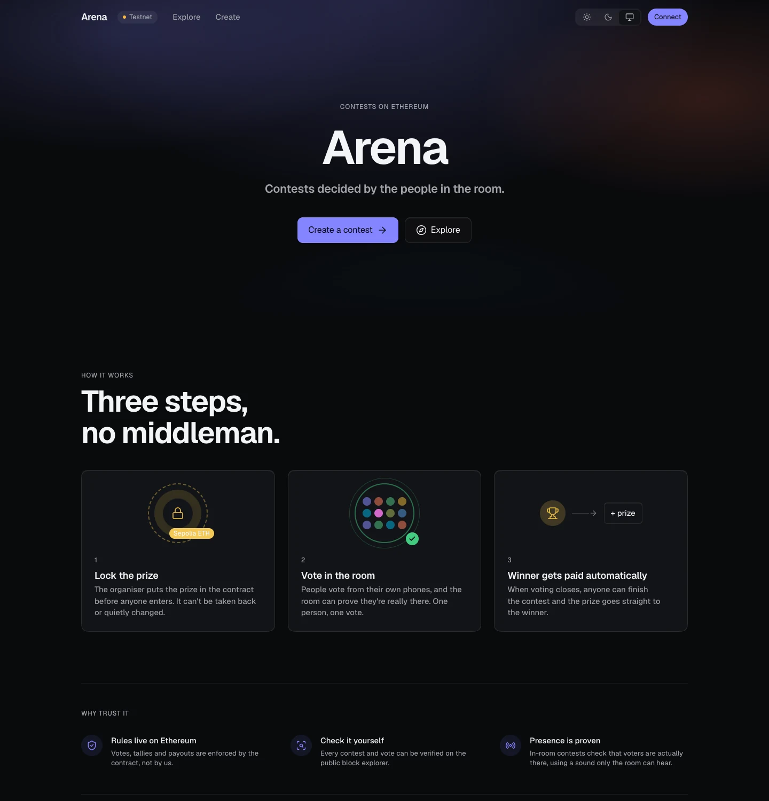

</div>

> [!NOTE]
> Arena runs on the **Ethereum Sepolia testnet** only. Every prize, drip and fee is free test ETH with no real value, and the app says so.

## What it is

Arena is a voting app for demo days, hackathon finals, college fests and design contests. An organiser creates a contest and locks an ETH prize in the contract, teams submit entries, and attendees vote from their phones. When voting closes, anyone can finalise the contest and the contract pays the winner. An optional feature called **Ground** proves a voter is physically at the venue, using an inaudible sound beacon and a door check-in, and the contract verifies both.

The four core features, and where they live:

- [x] **Create polls**: Create Contest wizard at [`/create`](https://arena-voting.vercel.app/create): basics, timing, who can vote, prize.
- [x] **Connect an Ethereum wallet**: one Connect sheet built on wagmi 3: any browser wallet (EIP-6963), WalletConnect, and Base Account passkeys behind a flag.
- [x] **Cast votes**: tap an entry on `/c/[id]` and confirm in your wallet; the contract's `vote()` checks every rule.
- [x] **View results**: live hemicycle and ranked list on `/c/[id]` and the projector view `/c/[id]/stage`, then final results and payout.

## Why it's different

| | |
|---|---|
| **Prize locked in the contract** | The organiser sends the prize with `createContest`. It can't be taken back or quietly changed, and the organiser can't change the timeline or remove entries once voting starts. |
| **Ground: presence verified on-chain** | *Room* mode needs a fresh token from the Stage's sound beacon (with a QR fallback). *Gated* mode adds a door check-in with a live, animated pass. The contract checks both, with no presence server. |
| **Live hemicycle results** | One seat per vote, coloured by entry, updating every few seconds on phones and on the projector. |
| **Winner paid by the contract** | After voting closes anyone can call `finalize`. Ties split equally, no votes refunds the organiser, and winners withdraw their share. No owner, no admin keys, no upgradeability. |

## Screenshots

Captions marked (live, Sepolia) are the production site; the rest come from a local test chain (Anvil).

<table>
  <tr>
    <td width="50%" valign="top">
      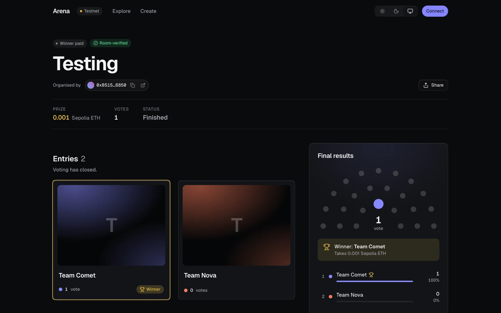
      <p align="center"><sub><b>Contest page</b>: entries, the winner and the final hemicycle (live, Sepolia).</sub></p>
    </td>
    <td width="50%" valign="top">
      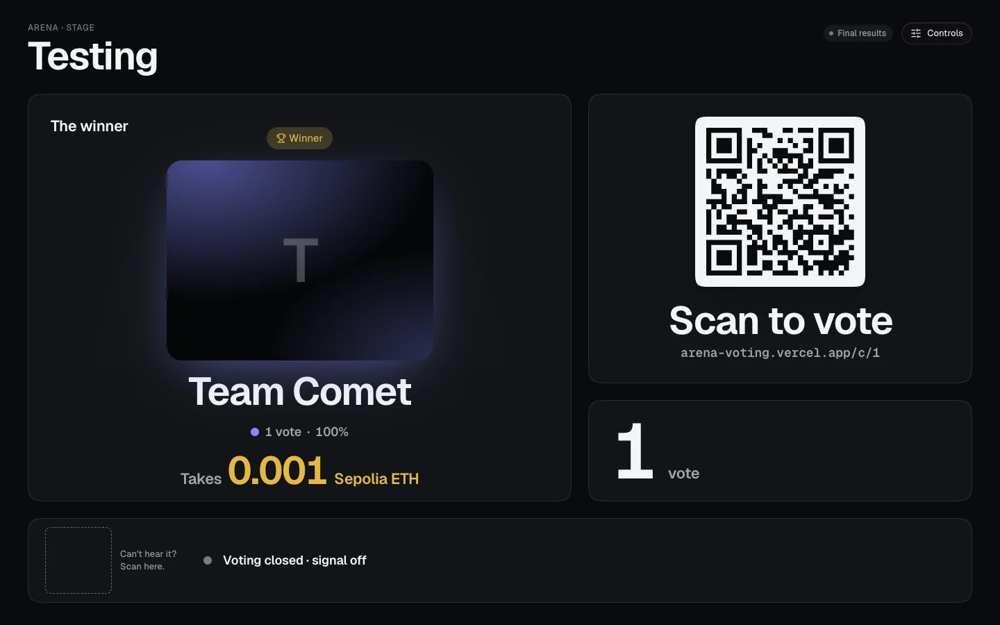
      <p align="center"><sub><b>Stage, after voting</b>: the winner and the prize they take (live, Sepolia).</sub></p>
    </td>
  </tr>
  <tr>
    <td width="50%" valign="top">
      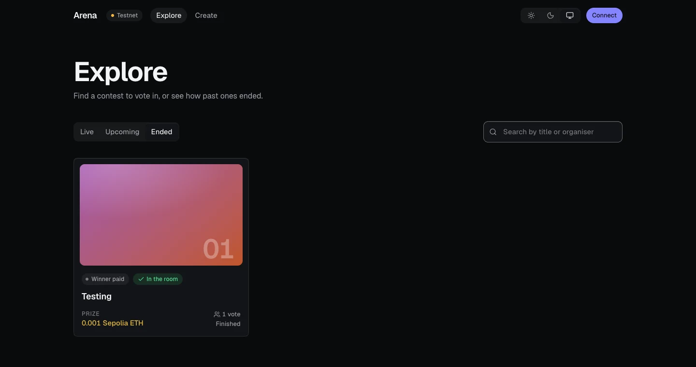
      <p align="center"><sub><b>Explore</b>: live, upcoming and ended contests with search (live, Sepolia).</sub></p>
    </td>
    <td width="50%" valign="top">
      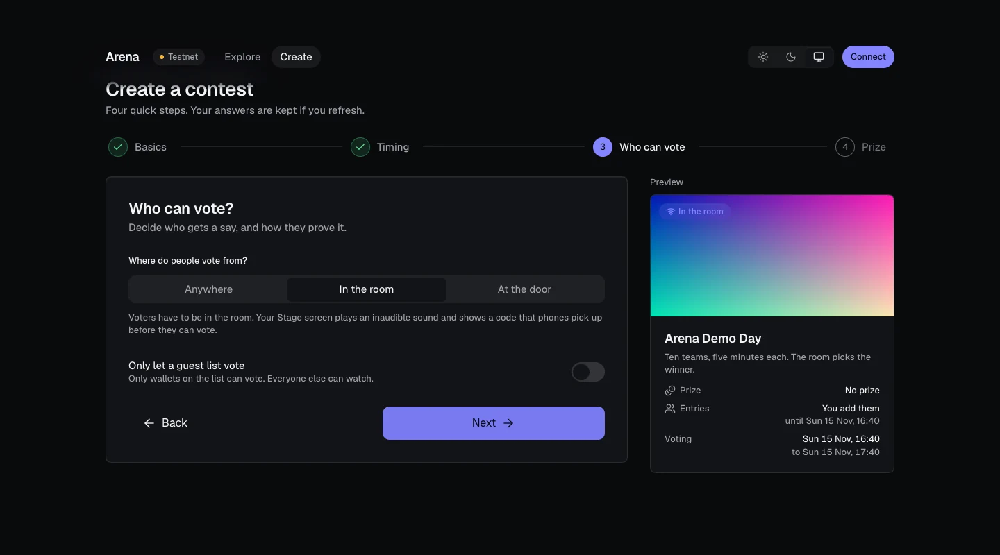
      <p align="center"><sub><b>Create wizard</b>: choosing between Anywhere, In the room and At the door.</sub></p>
    </td>
  </tr>
  <tr>
    <td width="50%" valign="top">
      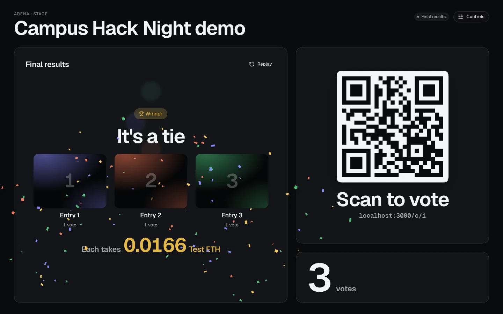
      <p align="center"><sub><b>Winner reveal</b>: a three-way tie, so the prize is split equally.</sub></p>
    </td>
    <td width="50%" valign="top">
      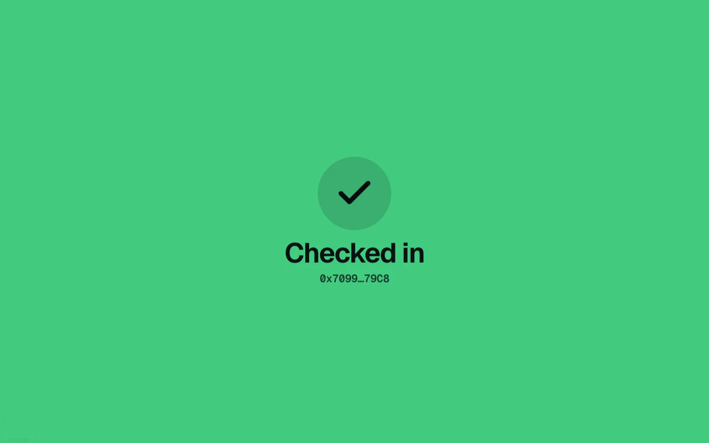
      <p align="center"><sub><b>Gate</b>: a valid pass flashes green and the next person can step up.</sub></p>
    </td>
  </tr>
  <tr>
    <td colspan="2" valign="top" align="center">
      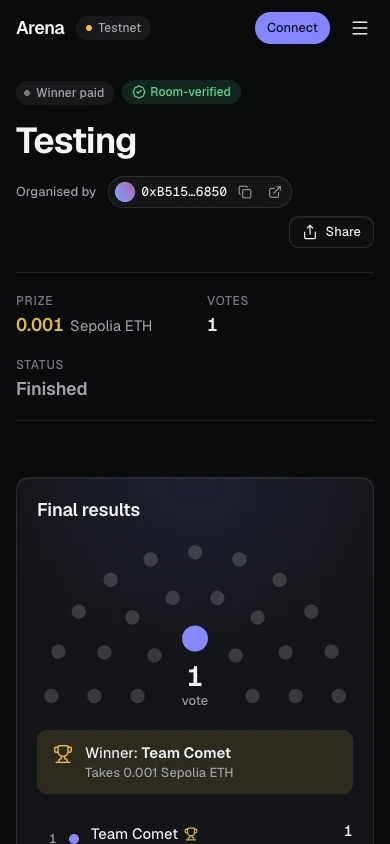
      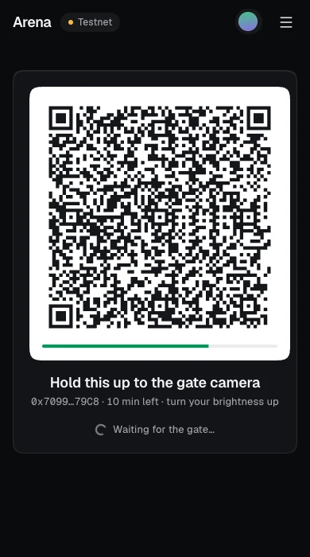
      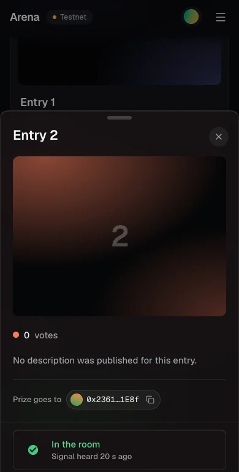
      <p align="center"><sub><b>Phone</b>: the rehearsal contest (live, Sepolia), the live door pass, and an entry sheet once the room signal is heard.</sub></p>
    </td>
  </tr>
</table>

## How it works

A contest has one of three presence modes: **Anywhere** (no presence check), **Room** (a fresh beacon token is required to vote) and **Gated** (door check-in plus the beacon). An optional ticket list (a Merkle allowlist of wallets) works with any mode.

**The room signal.** The Stage laptop builds a one-way hash chain from a secret seed and publishes only its end (the anchor) on-chain. Every 10 seconds it broadcasts the next token back down the chain as inaudible sound, and as a small QR on screen for phones that can't hear it. A token is 16 bytes, so it transmits quickly, and the contract can check it by hashing forward to the anchor. Nobody can compute the next token from the current one.

<details open>
<summary><b>A vote in Room mode</b></summary>

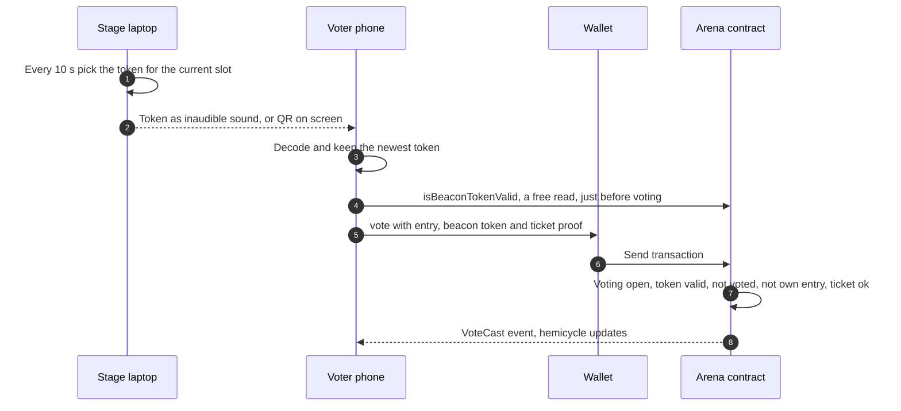

</details>

**The door pass.** In Gated mode the voter's wallet signs one check-in request (no fee) over a throwaway session key. The phone then shows a pass QR that changes every 2 seconds, each frame signed by that session key, so a screenshot stops working within seconds. The Gate device verifies it and checks the voter in on-chain from its own burner wallet, dripping a little Sepolia ETH so the voter can pay for their vote.

<details open>
<summary><b>Door check-in in Gated mode</b></summary>

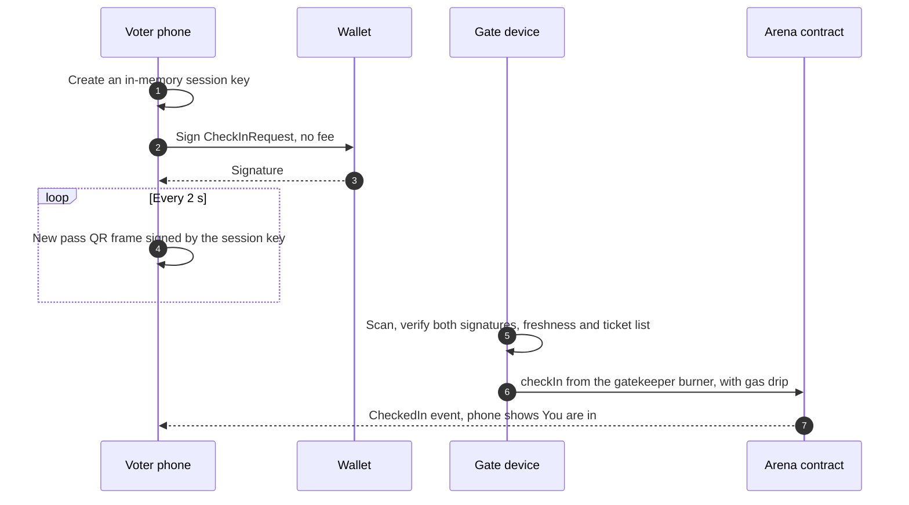

</details>

What each mode stops, in short (full table in [ground-presence.md](docs/ground-presence.md#threat-model)):

| Attack | Anywhere | Room | Gated |
|---|---|---|---|
| Vote from home, alone | allowed | blocked | blocked |
| A friend in the room forwards the token to someone at home | allowed | possible within ~2 min | blocked |
| Record the sound and replay it later | n/a | blocked | blocked |
| Screenshot someone's door pass | n/a | n/a | blocked |
| Entrant votes for their own entry | blocked | blocked | blocked |

Ground does not make cheating impossible. It makes remote and mass cheating cost more than a contest is worth, and the contract publishes exactly what was verified.

## Architecture

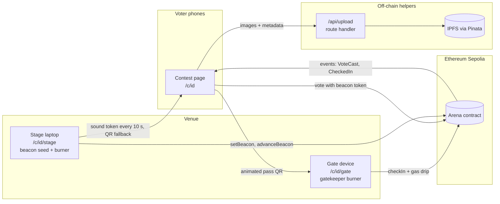

There is no backend that holds state. The web app is server-rendered Next.js with client islands, plus one stateless route handler (`/api/upload`) that keeps the IPFS secret off the client.

<details>
<summary><b>What's on-chain and what's off-chain</b></summary>

| Data or rule | Where | Why |
|---|---|---|
| Contest config, timing, prize escrow | Contract storage | Enforced and auditable |
| Entries: payee, members, metadata URI, vote count | Contract storage | Self-vote ban and tallies are enforced |
| Entry name, image, description | IPFS JSON, URI in the contract | Too big for storage |
| Ticket list | Merkle root in the contract, full list on IPFS | 32 bytes on-chain; frozen once voting or check-in starts |
| Beacon anchor, start, length, cache | Contract storage | The contract verifies tokens without a server |
| Beacon seed | Stage laptop only | Secret; recoverable by re-signing |
| Gate and Stage burner keys | Device localStorage | Hot keys with tiny balances; can only check people in or advance the beacon |
| Check-ins and votes | Contract storage + events | Source of results |

</details>

<details>
<summary><b>Trust model</b></summary>

| Actor | Trusted for | Not trusted for |
|---|---|---|
| Contract | Everything it enforces | n/a |
| Organiser | Presence (holds the beacon seed, appoints gatekeepers), curating entries before voting | Tallies, payouts, changing timing after creation, removing entries during voting |
| Gatekeeper key | Checking in wallets it has seen at the door | Voting for anyone, moving the prize |
| Frontend / Vercel | UX only | Any rule: a malicious frontend can't make an ineligible vote count |
| IPFS / Pinata | Availability of metadata | Correctness of results |
| RPC provider | Availability | Correctness: the wallet signs and the contract enforces |

</details>

## Tech stack

All versions are pinned exactly (no `^`).

| Layer | What | Version |
|---|---|---|
| Contracts | Solidity (`evm_version = prague`) | 0.8.38 |
| | Foundry (forge, anvil, cast) | 1.9.0 |
| | OpenZeppelin Contracts (`MerkleProof`, `ReentrancyGuard`) | 5.7.0 |
| | forge-std | 1.17.0 |
| Web | Next.js (App Router, Turbopack) | 16.4.6 |
| | React | 19.3.1 |
| | TypeScript | 6.0.3 |
| | Tailwind CSS | 4.3.5 |
| | Motion | 14.14.0 |
| Ethereum client | wagmi | 3.7.11 |
| | viem | 2.57.20 |
| | @tanstack/react-query | 5.107.1 |
| | @wagmi/cli (typed ABI from Foundry output) | 2.10.1 |
| | @walletconnect/ethereum-provider | 2.26.0 |
| | @base-org/account (passkey wallet) | 2.6.0 |
| Ground | ggwave (data over sound, WASM) | 0.4.0 |
| | @zxing/browser (QR reading) | 0.2.1 |
| | qrcode.react | 4.2.0 |
| | @openzeppelin/merkle-tree | 1.0.8 |
| Data | zod | 4.6.7 |
| | pinata (server only) | 2.5.8 |
| Testing | Vitest | 5.1.0 |
| | Testing Library (React) | 16.3.3 |
| | Playwright | 1.65.1 |
| Tooling | Node.js | `>=24 <27` (26.7.0 locally) |
| | pnpm | 10.34.9 |
| Services | Sepolia RPC (Alchemy or Infura), Etherscan, Reown (WalletConnect), Pinata, Vercel | |

## Quick start (local)

**Prerequisites:** Node.js 24 to 26 (`.nvmrc` pins 26.7.0), pnpm 10.34.9, [Foundry](https://getfoundry.sh) v1.9.0 (`foundryup --install v1.9.0`) and `jq`.

```bash
pnpm install
pnpm setup:contracts   # install forge-std v1.17.0 and OpenZeppelin v5.7.0 into contracts/lib
pnpm chain             # anvil --block-time 2 on :8545 (leave it running)
```

In a second terminal:

```bash
pnpm deploy:local      # deploy, seed demo contests and votes; writes contracts/deployments/31337.json
pnpm gen               # forge build, copy deployments into web/, generate the typed ABI
cp web/.env.example web/.env.local   # then set NEXT_PUBLIC_ENABLE_ANVIL=1
pnpm dev               # http://localhost:3000
```

To vote locally, import Anvil account #0 into a browser wallet. Its key is the public Anvil default; never use it on a real network.

<details>
<summary><b>Environment files</b></summary>

There are two. Foundry reads the root `.env`; Next.js reads `web/.env.local`. Both are gitignored and both have committed examples with placeholder values.

[`.env.example`](.env.example) (Sepolia deploys only):

```bash
SEPOLIA_RPC_URL=https://eth-sepolia.g.alchemy.com/v2/your-private-key
DEPLOYER_PRIVATE_KEY=0xyour-fresh-testnet-only-key
ETHERSCAN_API_KEY=your-etherscan-key
```

[`web/.env.example`](web/.env.example):

```bash
# public (inlined into the browser bundle)
NEXT_PUBLIC_SEPOLIA_RPC_URL=https://eth-sepolia.g.alchemy.com/v2/your-public-origin-restricted-key
NEXT_PUBLIC_WC_PROJECT_ID=your-reown-project-id
NEXT_PUBLIC_PINATA_GATEWAY=your-subdomain.mypinata.cloud
NEXT_PUBLIC_ENABLE_ANVIL=0
NEXT_PUBLIC_E2E=0
# server only
PINATA_JWT=your-pinata-jwt
SEPOLIA_RPC_URL=https://eth-sepolia.g.alchemy.com/v2/your-private-key
NEXT_PUBLIC_ENABLE_BASE_ACCOUNT=0
```

Flags are `"1"` for on, anything else for off. For a local chain only `NEXT_PUBLIC_ENABLE_ANVIL=1` is needed.

</details>

## Deploying to Sepolia

```bash
cd contracts
source ../.env
forge script script/Deploy.s.sol --rpc-url "$SEPOLIA_RPC_URL" --private-key "$DEPLOYER_PRIVATE_KEY" --broadcast --verify --etherscan-api-key "$ETHERSCAN_API_KEY"
```

`Deploy.s.sol` only accepts Sepolia (`11155111`) and Anvil (`31337`) and writes `contracts/deployments/<chainId>.json`; run `pnpm gen` afterwards. The web app deploys to Vercel with `web` as the root directory. The current deployment is [`0x2dC9d04Dd8f724C936aE7C200F73763e20662c34`](https://sepolia.etherscan.io/address/0x2dC9d04Dd8f724C936aE7C200F73763e20662c34#code) (source verified). Accounts, environment variables and the demo-day runbook are in [docs/deployment.md](docs/deployment.md).

## Testing

| Suite | Command | Count |
|---|---|---|
| Contracts: unit, fuzz, invariants, cross-language parity | `pnpm test:contracts` | **227** tests, 100% line and branch coverage on `Arena.sol` and `BeaconChain.sol` |
| Web: unit and component (Vitest + Testing Library) | `pnpm test:web` | **646** tests |
| End to end (Playwright on a local Anvil chain) | `pnpm e2e` | **44** tests on iPhone-sized WebKit and desktop Chromium |

`pnpm test` runs the contract and web suites together. `cd contracts && forge coverage` reports coverage, and `FOUNDRY_PROFILE=ci forge test` runs fuzz and invariant tests with more runs. Install Playwright's browsers once with `pnpm -C web exec playwright install`.

<details>
<summary><b>What the end-to-end suite covers</b></summary>

Playwright starts its own Anvil chain, deploys the contract and runs the app against it with a mock wallet connector. Each spec runs at phone and desktop sizes and fails on any console error.

- **browse**: landing, explore tabs, contest results without a wallet, connect prompt on vote.
- **create**: create a Room contest with a prize, validation errors, landing on the manage page.
- **vote-room**: Stage sets the beacon, a beacon payload is injected (sound can't run headless), vote, and the hemicycle updates in a second browser without a reload; a second vote is blocked.
- **gated**: the organiser authorises a Gate, the voter shows a pass, the Gate accepts it; voting without check-in is blocked and works after.
- **finalize**: time travel past the end, finalise, the winner claims and their balance goes up.
- **errors**: already-voted copy before the wallet opens, wrong-network prompt, rejection copy.
- **manage-submit**: curated add and remove, open submission by a stranger, ticket list upload.
- **stage**: the beacon payload rotates each slot; a 40 s clock skew shows the warning chip.

Sound transmission, cameras and wallet apps are checked on real devices with the checklist in [docs/testing.md](docs/testing.md#real-devices).

</details>

## Project structure

```
contracts/
  src/Arena.sol              the contract: contests, entries, votes, check-ins, payouts
  src/lib/BeaconChain.sol    hash-chain beacon verification
  test/                      Foundry unit, fuzz, invariant and parity tests
  script/                    Deploy, Seed and local deploy scripts
  deployments/11155111.json  Sepolia address and start block
web/
  src/app/                   Next.js routes (/, /explore, /create, /c/[id], stage, gate, manage, /me)
  src/components/            UI by feature: contest, create, stage, gate, presence, wallet, ui
  src/lib/                   beacon chain, pass encoding, ticket lists, hemicycle layout
  src/config/                network, contracts and wagmi setup
  e2e/                       Playwright specs
docs/                        product, architecture, contract spec, presence protocol, decisions
spikes/sound/                device test page for the sound beacon
```

## Honest limits

- **One wallet is not one human.** Ticket lists and Gated mode limit abuse; proof of personhood is future work.
- **The organiser is trusted for presence**, because they hold the beacon seed and the gatekeeper keys. They are not trusted for tallies or payouts, which the contract enforces.
- **A decoded beacon token is data** and can be forwarded within its ~2-minute window. In Gated mode, only wallets that physically checked in can use it. See the [threat model](docs/ground-presence.md#threat-model).
- **Votes are public on-chain**: anyone can see who voted for what.
- **Testnet only for now.** Mainnet would need an independent audit and the rest of the readiness checklist in decision D-21.
- **Room-mode voters need a little Sepolia ETH** of their own (the app links a faucet). Only Gated mode drips it at the door.

## Design decisions

From the [decision log](docs/decisions.md):

- **Presence without a server (D-02).** All presence rules are verified by the contract. A backend presence oracle, GPS, NFC tags and a rotating QR alone were rejected.
- **Hash chain, not signatures, for beacon tokens (D-03).** Data over sound carries tens of bytes per second; a 16-byte chain link is about 3x shorter than a signed token.
- **wagmi 3 with our own Connect sheet (D-04).** RainbowKit and ConnectKit don't support wagmi 3, and Reown AppKit imposes its own look.
- **Gas drip at check-in (D-07).** Attendees won't have Sepolia ETH, so the Gate forwards a small drip inside `checkIn` instead of sending people to a faucet.
- **Live pass QR with a session key (D-08).** One wallet signature, then a pass that changes every 2 s, so screenshots expire.
- **Pull payments for prizes (D-09).** `finalize` credits balances and winners withdraw, so one payee that can't receive ETH can't block everyone else.

## Documentation

| Doc | What it covers |
|---|---|
| [docs/README.md](docs/README.md) | Index and glossary |
| [docs/product.md](docs/product.md) | Users, flows, scope and limits |
| [docs/architecture.md](docs/architecture.md) | Components, on-chain vs off-chain, trust model, pinned stack |
| [docs/contracts.md](docs/contracts.md) | Contract spec: functions, rules, errors, invariants |
| [docs/ground-presence.md](docs/ground-presence.md) | Beacon, door pass and threat model |
| [docs/design-system.md](docs/design-system.md) | Tokens, type, colour, motion, components |
| [docs/frontend.md](docs/frontend.md) | App structure, routes, data layer, wallet connection |
| [docs/testing.md](docs/testing.md) | Contract, unit, E2E and real-device testing |
| [docs/deployment.md](docs/deployment.md) | Environment, Sepolia deploy and verify, Vercel |
| [docs/decisions.md](docs/decisions.md) | Decision log with rejected alternatives |

---

<div align="center">
<sub>Built by <a href="https://github.com/MaanavKrishna">Maanav Krishna</a></sub>
</div>
