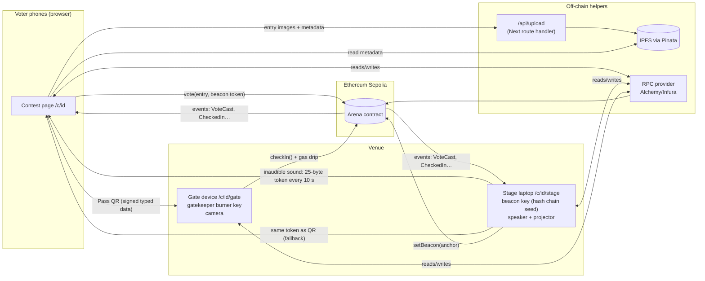
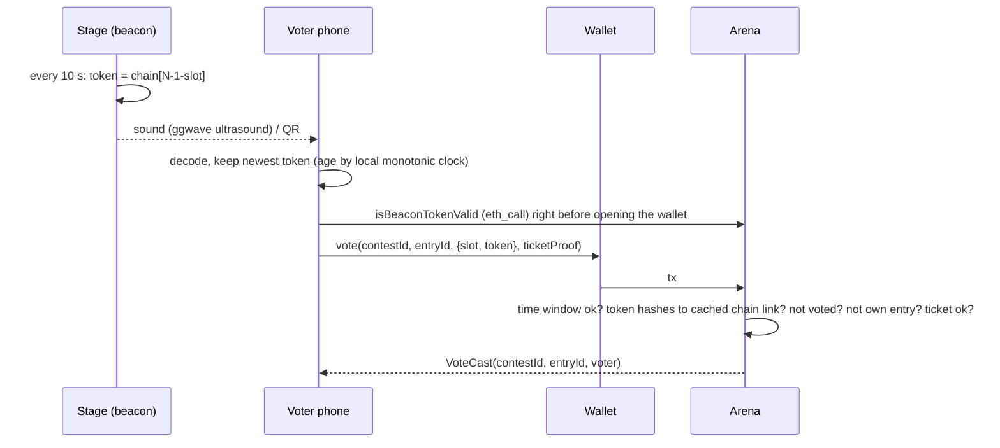

# Architecture

## Principles
0. **Testnet for now, network-configurable.** This phase runs on the Ethereum **Sepolia testnet** (`11155111`) and local Anvil (`31337`). The target network is chosen in **one place** per side (`web/src/config/network.ts` and the deploy scripts' allowed-chain list) so a later mainnet phase is a config change plus the D-21 checklist — not a rewrite. Until the owner decides otherwise, mainnet is not configured, deployed to, or offered in the UI.
1. **Ethereum is the source of truth.** Every rule that decides who can vote, what counts, and who gets paid lives in the `Arena` contract. The frontend never decides eligibility on its own.
2. **No backend that holds state.** The website is server-rendered Next.js pages with client islands, plus one stateless route handler (`/api/upload`) that only exists to keep the IPFS secret off the client. Nothing the app needs is stored on a server.
3. **Trust is visible.** Every contest shows a verification badge (Anywhere / Room-verified / Door + Room verified) and live counts of checked-in wallets and votes. All of it is readable on Etherscan.
4. **Seamless for honest users, expensive for cheaters.** Layers stack; any single honest-user failure has a fallback.

## System diagram



## On-chain vs off-chain
| Data / rule | Where | Why |
|---|---|---|
| Contest config, timing, prize escrow | Contract storage | Enforced, auditable |
| Entries (payee, members, metadata URI, vote count) | Contract storage | Enforced self-vote ban and tallies |
| Entry name/image/description | IPFS JSON, URI in contract | Too big for storage |
| Ticket list | Merkle root in contract; full list JSON on IPFS (`ticketListURI`) | 32 bytes on-chain; voters/gate rebuild proofs from IPFS; frozen once voting or check-in starts |
| Beacon anchor, start, length, rotation, cache | Contract storage | Contract verifies tokens without a server; Stage can recover from chain state |
| Beacon seed + chain | Stage laptop memory/localStorage | Secret; recoverable by re-signing (see ground-presence.md) |
| Gatekeeper / Stage burner keys | Gate and Stage device localStorage | Hot keys with tiny balances; can only check people in / advance the beacon |
| Check-in status | Contract storage | Required by `vote()` in Gated mode |
| Votes | Contract storage + `VoteCast` event | Source of results |
| Sound/QR token transport | Air / screen | — |

## Trust model
| Actor | Trusted for | Not trusted for |
|---|---|---|
| Contract | Everything it enforces | — |
| Organiser | Presence (holds beacon seed, appoints gatekeepers), entry curation before voting | Tallies, payouts, changing timing after creation, removing entries during voting |
| Gatekeeper key | Checking in wallets it has seen at the door | Voting on behalf of anyone, moving the prize |
| Frontend / Vercel | UX only | Any rule (a malicious frontend cannot make an ineligible vote count) |
| IPFS / Pinata | Availability of metadata | Correctness of results |
| RPC provider | Availability | Correctness (wallet signs; contract enforces) |

## Key sequences

### Vote in Room mode


### Check-in in Gated mode
```mermaid
sequenceDiagram
  participant Ph as Voter phone
  participant W as Wallet
  participant G as Gate device
  participant C as Arena
  Ph->>Ph: create in-memory session key
  Ph->>W: signTypedData(CheckInRequest{contestId, voter, sessionKey, issuedAt})
  W-->>Ph: signature
  Ph->>Ph: animated Pass QR: request + wallet sig + tick (every 2 s) signed by session key
  G->>G: camera reads QR; verifyTypedData (ERC-1271/6492 aware); issuedAt ≤ 10 min; tick fresh; ticket proof from IPFS list; not checked in
  G->>C: checkIn(contestId, voter, ticketProof) {value: drip} from gatekeeper burner
  C-->>Ph: CheckedIn event → "You're in ✓"
```

## Tech stack (pinned, verified latest compatible on 2026-11-15)

Versions were checked against the npm registry and GitHub releases. **Use exact versions** in `package.json` (no `^`) so builds are reproducible; bump deliberately with `pnpm outdated`.

### Runtime and tooling
| Tool | Version | Note |
|---|---|---|
| Node.js | 26.7.0 (installed; 26.13.1 is latest LTS) | `.nvmrc` = `26.7.0`, `engines.node` = `>=26.7.0 <27` — see D-22 |
| pnpm | 10.34.9 (installed) | `"packageManager": "pnpm@10.34.9"` (no Corepack on this machine — D-22). Build scripts allowed via `onlyBuiltDependencies` in `pnpm-workspace.yaml` |
| Foundry (forge/anvil/cast) | v1.9.0 | `foundryup --install v1.9.0` |
| Solidity | 0.8.38 | `solc = "0.8.38"`, `evm_version = "prague"` |
| forge-std | v1.17.0 | `forge install foundry-rs/forge-std@v1.17.0` |
| OpenZeppelin Contracts | v5.7.0 (latest GitHub release; npm still shows 5.6.1, irrelevant — Foundry installs from git) | `forge install OpenZeppelin/openzeppelin-contracts@v5.7.0` |

### Web app
| Package | Version | Why this one |
|---|---|---|
| next | 16.4.6 | App Router, Turbopack default. Bundled docs in `node_modules/next/dist/docs` — read them, APIs changed vs older training data |
| react, react-dom | 19.3.1 | |
| typescript | **6.0.3** (not 7.x) | typescript-eslint 8.72 supports `<6.1.0`; TS 7 breaks linting |
| tailwindcss, @tailwindcss/turbopack | 4.3.5 | CSS-first config (`@theme` in CSS). Next 16.4 loads Tailwind through a Turbopack loader in `next.config.ts` — no PostCSS config (D-24) |
| motion | 14.14.0 | motion.dev; import from `motion/react` |
| wagmi | 3.7.11 | |
| viem | 2.57.20 | |
| @tanstack/react-query | 5.107.1 | wagmi peer |
| @wagmi/cli | 2.10.1 | Generates typed ABI from Foundry output |
| @base-org/account | 2.6.0 | Peer for wagmi `baseAccount` connector (passkey smart wallet) |
| @walletconnect/ethereum-provider | 2.26.0 | Peer for wagmi `walletConnect` connector |
| @openzeppelin/merkle-tree | 1.0.8 | Ticket list tree, matches OZ `MerkleProof` |
| ggwave | 0.4.0 | Data-over-sound (WASM). **Unmaintained since 2022** — spike first. If bundling fails, copy the files from this same npm package into `public/vendor/ggwave/` (no other build) |
| @zxing/browser | 0.2.1 | QR reading where `BarcodeDetector` is missing (Safari, Firefox) |
| qrcode.react | 4.2.0 | QR rendering |
| zod | 4.6.7 | Form + IPFS metadata validation |
| pinata | 2.5.8 | Server-side only, in `/api/upload` |
| geist | 1.9.2 | Geist Sans + Geist Mono fonts |
| lucide-react | 1.73.0 | Icons |
| clsx, tailwind-merge | 2.1.1, 3.7.0 | `cn()` helper |

### Wallet connection decision
**RainbowKit 2.2.11 requires wagmi ^2 and ConnectKit requires wagmi 2 + React ≤ 18**, so neither works with wagmi 3. Reown AppKit works but imposes its own look. **Decision: wagmi 3 + our own Connect sheet** built in the design system (see [decisions.md](decisions.md#d-04)). Connectors: `injected()` with EIP-6963 multi-wallet discovery (MetaMask, Rabby, Brave, Coinbase extension…), `walletConnect({ showQrModal: false })` with our own QR, `baseAccount()` for passkey smart wallets, and `mock()` in E2E mode.

### Dev and test
| Package | Version |
|---|---|
| vitest | 5.1.0 |
| @vitejs/plugin-react | 6.3.0 |
| jsdom | 31.0.1 |
| @testing-library/react | 16.3.3 |
| @playwright/test | 1.65.1 |
| eslint | 9.39.5 (D-23: eslint-config-next plugins don't support 10 yet) |
| eslint-config-next | 16.4.6 |
| typescript-eslint | 8.72.2 |
| prettier, prettier-plugin-tailwindcss | 3.10.1, 0.8.1 |
| @types/react, @types/react-dom, @types/node | 19.3.0, 19.3.0, 26.6.6 |

### Services
| Service | Use | Free tier ok? |
|---|---|---|
| Ethereum Sepolia | Deployment chain (id `11155111`, ~12 s blocks) | Yes |
| Alchemy or Infura | RPC (HTTPS) | Yes |
| Etherscan API v2 | Contract verification | Yes |
| Reown (WalletConnect) Cloud | Project ID for WalletConnect | Yes |
| Pinata | IPFS pinning + gateway | Yes |
| Vercel | Hosting | Yes |

## Repository layout
```
/
  README.md            public project README (written last)
  .env.example         every env var with placeholder values
  .nvmrc  package.json (workspace root)  pnpm-workspace.yaml
  contracts/           Foundry project
    foundry.toml  remappings.txt
    src/Arena.sol
    src/lib/BeaconChain.sol       hash-chain verification library
    test/Arena.Create.t.sol  Arena.Entries.t.sol  Arena.Vote.t.sol
    test/Arena.Beacon.t.sol  Arena.Gate.t.sol  Arena.Finalize.t.sol
    test/Arena.Invariant.t.sol    test/fixtures/*.json
    script/Deploy.s.sol  script/Seed.s.sol
    deployments/<chainId>.json    { "address", "block" } — 11155111.json committed, 31337.json gitignored
  web/                 Next.js app (see frontend.md for full tree)
  docs/                these documents
  docs/plans/          implementation plan + progress ledger (git-excluded)
  spikes/              throwaway experiments (sound spike), not imported by web/
```
Root `package.json` scripts proxy into `web/` and `contracts/` (see [frontend.md](frontend.md#scripts)).
